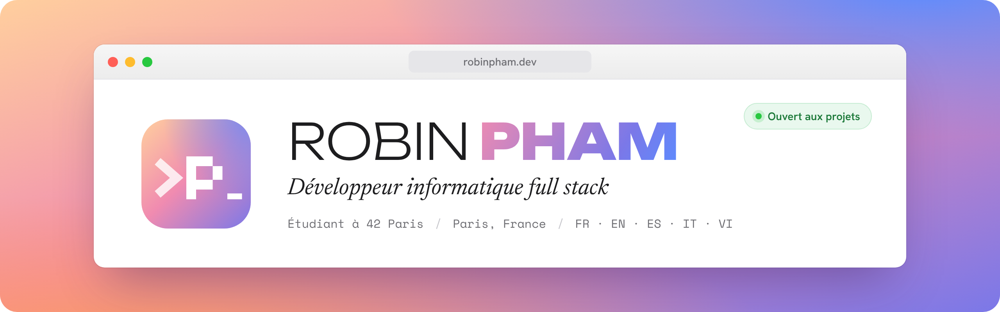
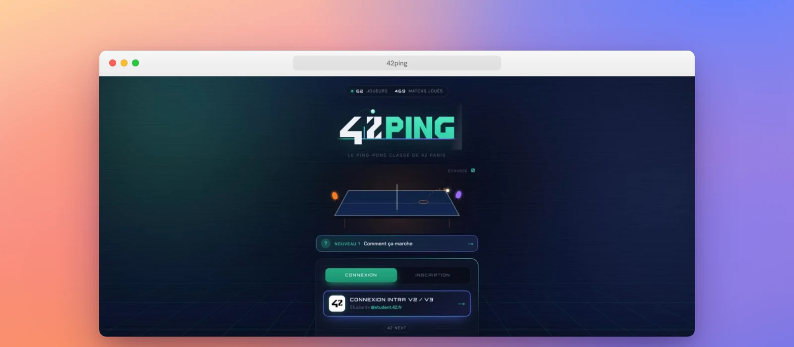

  

## À propos

- 🎓 Étudiant à **42 Paris** depuis avril 2026
- 💻 Développeur **full stack** : du C bas niveau aux applications web complètes, front et back
- 🎨 Attentif au design et à l'UI/UX, je maquette sur Figma avant de coder
- 🌍 Je parle français, anglais, espagnol, italien et vietnamien
- 📫 Ouvert aux projets et aux propositions : [robinpham.dev](https://robinpham.dev)

## Projet phare

### [42Ping](https://42ping.ropham.xyz) &nbsp;·&nbsp; le ping-pong classé de 42 Paris

Une app web full stack où les étudiants de 42 Paris se défient au ping-pong, déclarent leurs scores et grimpent dans un classement ELO, de Bronze à Diamant. Conçue et développée seul, de A à Z.

<table>
  <tr>
    <td align="center"><b>62</b> joueurs</td>
    <td align="center"><b>469</b> matchs joués</td>
    <td align="center"><b>Tous les jours</b> utilisée à l'école</td>
  </tr>
</table>

- **Anti-triche** : le navigateur n'écrit jamais en base. Chaque action passe par des fonctions SQL protégées (security definer + RLS), et le calcul ELO se fait en une seule opération côté base.
- **Connexion via l'intra 42** grâce à l'API officielle, comptes réservés aux étudiants.
- Mode duo avec son propre ELO, paliers qui changent le thème du profil, notifications push, tableau de bord admin, page de statistiques.

  
  
  
  
  
  
  

👉 **[Voir l'app en ligne](https://42ping.ropham.xyz)** &nbsp;·&nbsp; **[Lire l'étude de cas complète](https://robinpham.dev)**

## Stack

  

## Langages sur GitHub

  

## Me contacter

  
  
  

